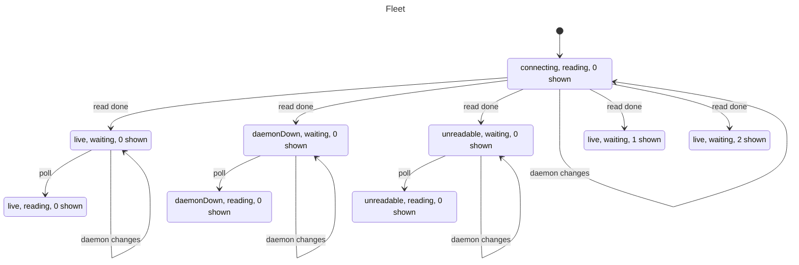
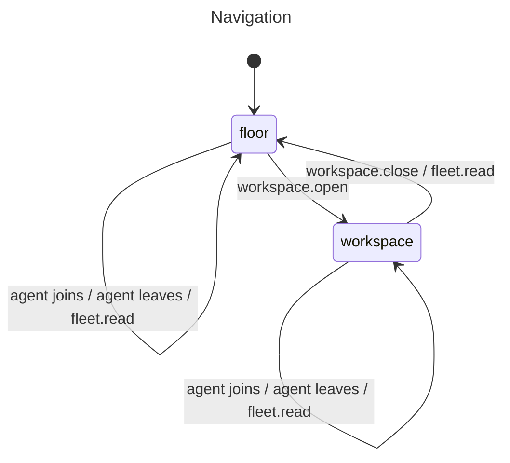
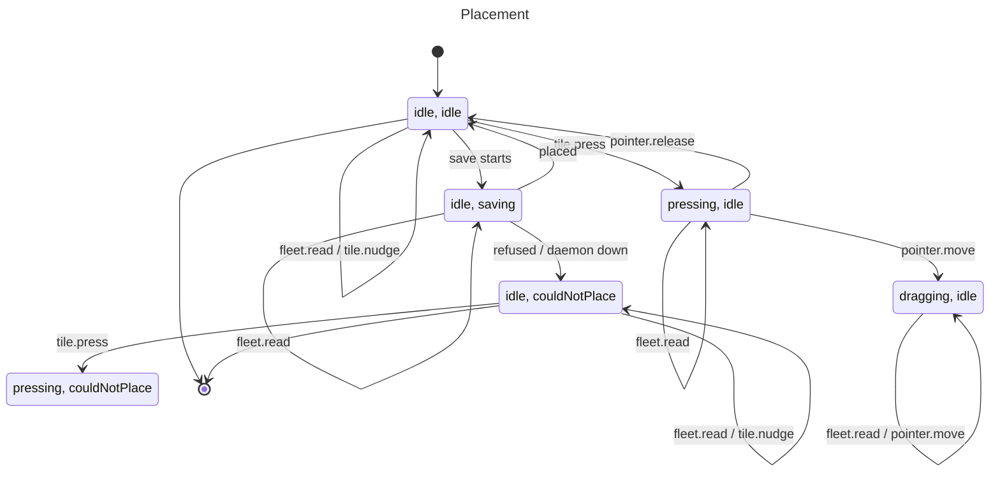

# wake-window

The Wake desktop window: a viewer of the Rust daemon. It shows every agent the daemon lists as a machine on a floor, lets you place the machines, and opens a workspace for one of them. Closing the window leaves the agents running.

This folder is the only JavaScript in the repository, so the lint, format and type-check configuration lives here.

## Run

```sh
cargo build -p wake-cli
```

```sh
target/debug/wake daemon
```

```sh
cd apps/wake-window && npm ci && npm run dev
```

`WAKE_SOCKET` sets the daemon's socket (default `~/.wake/wake.sock`), the same variable the `wake` command reads.

## Stack

- Electron: the main process opens one sandboxed window and forwards two daemon methods. The preload passes the two calls through and runs no library code.
- React 19 for the views, with `@ui-sdk/react` (UI SDK, in beta) for behavior such as the workspace tabs.
- XState 5 for all client state, through `@xstate/react` in one provider file.
- Effect 4: `Schema` is the single source of the wire types, and the daemon client is an Effect with a scoped socket, a timeout and a tagged error.
- Keel's stylesheet for Keel components, and StyleX for the window's own styles on a typed module of Keel's tokens.
- earnest models beside the state machines, checked by `earnest verify`.
- ultracite's presets for oxlint and oxfmt; TypeScript 7 through `effect-tsgo`, with `tsc` and `tsrs`.

SolidJS was the first choice and was dropped: `@xstate/react` and `@ui-sdk/react` are the official adapters, and React has lint rules and react-doctor.

## Layout

| Path | Holds |
| --- | --- |
| `src/shared/` | wire schemas (`agent.ts`), the answer and reading types, the bridge contract |
| `src/main/` | the window, the daemon client and the two forwarded methods |
| `src/preload/` | the bridge: two functions that return what the main process answers |
| `src/renderer/floor/*-model.ts` | pure geometry and tile text: snap, slots, overlap, lamp tone, relative time |
| `src/renderer/window/*-model.ts` | the machines' context and its pure transitions |
| `src/renderer/**/*-machine.ts` | XState machines: fleet, placement, navigation, theme |
| `src/renderer/**/*.model.ts` | earnest models of the fleet, placement and navigation regions |
| `src/renderer/window/window-provider.tsx` | the only file that imports `@xstate/react`; decodes the bridge's answers |
| `src/renderer/**/*.tsx` | views: they read the machine's snapshot and send it events |
| `src/renderer/keel/` | Keel's `tokens.css`, `bundle.css`, fonts and the typed token module |
| `lint/wake-styles.mjs` | two lint rules for the CSS gates |
| `tests/` | vitest tests, fast-check properties and the contract test |

## The daemon

The window uses two methods of the daemon's JSON-RPC socket and nothing else:

| Method | Use |
| --- | --- |
| `agent.list` | read every 2 seconds; each agent carries its `position`, or none |
| `floor.place` | sent when a machine is dropped, moved with the keyboard, or first placed |

The daemon owns the positions. The window keeps tile size (280 by 160), the 20 px grid and the slot layout, and sends plain pixel coordinates.

## The floor

- Drag a machine to move it. It snaps to the 20 px grid and never goes below zero on either axis.
- A press that moves less than 5 px is a click and opens the machine's workspace. Enter and Space open a focused machine.
- Alt with an arrow key moves the focused machine one grid step.
- An agent the daemon has not placed takes the first free slot on a 320 by 220 pitch, three columns from (40, 40), and the window sends that slot to the daemon once.
- A dropped position shows at once and stays until a reading from the daemon agrees. If the daemon refuses or cannot be reached, the machine returns and an alert above the floor says why.
- The minimap at the bottom right mirrors the floor at 0.15 scale.
- A phase is shown as the agent wrote it. The lamp knows four words: `planning` and `working` are green and `working` pulses, `review` is amber, `done` is blue. Anything else is grey.

## State

One XState machine, `window-machine.ts`, with three parallel regions, and a small `theme-machine.ts`. Each region has an earnest model beside it that uses the machine's state and event names. The charts below are `earnest chart src --max-arrows 12`.



Not shown: 78 of 168 states and 66 of 78 arrows.





Not shown: 569 of 1358 states and 19 of 31 arrows.

Rules the models check, each also a fast-check property or an example test with the same words:

| Model | Rule |
| --- | --- |
| Fleet | A failed read after a good one keeps the last agents |
| Fleet | The fleet is connecting only until its first read finishes |
| Fleet | Right after a good read the floor shows what the daemon listed |
| Navigation | The workspace is never open for an agent that left the fleet |
| Navigation | An agent is opened exactly while the workspace shows |
| Placement | A tile is never both being dragged and being saved |
| Placement | A press that never moves 5 px never places anything |
| Placement | An unplaced agent is sent to the daemon at most once, not counting sends the daemon never received |
| Placement | A pending position is dropped only when the daemon agrees or refuses |
| Placement | After a refused save the tile shows the daemon's position and the reason is shown |
| Placement | A place is being sent only while one is pending |

The models leave out pixel geometry, more than one tile in the placement model, and the theme machine.

## CSS

- `keel/tokens.css` and `keel/bundle.css` are the only stylesheets, imported once in `main.tsx`. `bundle.css` is Keel's file, byte for byte.
- Keel components use Keel's `k-` classes. `className` is written by hand only for those.
- Everything else is `stylex.create` beside its component. Colors, shadows, radii and font families come only from `keel/keel-tokens.stylex.ts`, a `defineConsts` module whose values are Keel's existing `var(--name)` references. A test fails when that module and `tokens.css` differ.
- Lamp tones are a record typed by the model's `LampTone`, so a new tone without a style fails the type check.
- A machine's place and a minimap mark's box are StyleX dynamic styles. There is no `style` prop. Tile size and grid step come from the floor model at run time, so the model and the CSS cannot drift.
- The pulse and the loading shimmer stop under `prefers-reduced-motion`.
- No stylelint: with the app's CSS typed, it has nothing to lint.

## Gates

`npm run verify` runs them in order, and `just check` at the repository root runs it after building the `wake` binary:

1. `oxfmt --check`, with ultracite's preset.
2. `effect-tsgo oxlint --type-aware`: ultracite's core, React and vitest presets, the StyleX plugin, the comment ban and the gates below.
3. `effect-tsgo tsc`: every strict flag and every Effect diagnostic at error.
4. `effect-tsgo tsrs`: the same project through tsrs. It reports the Effect diagnostics too; both run, as in the reference setup.
5. `earnest verify src`.
6. `vitest run`: examples, 12 fast-check properties and the contract test against the real `target/debug/wake daemon`.
7. `react-doctor`, offline: no score API and no supply-chain scan.
8. `electron-vite build`.

Gates in `oxlint.config.ts`:

| Files | Banned |
| --- | --- |
| all | comments; `useState`, `useReducer`, `useSyncExternalStore`; importing a `*.model.ts`; importing a stylesheet (except `main.tsx`); `node:net` (except `src/main`) |
| views | `useEffect` and its siblings, `xstate`, `@xstate/react`, `electron`, `node:*`, `src/main`, `src/preload` |
| `window-provider.tsx` | as views, but may import `xstate`, `@xstate/react` and run effects |
| `theme/theme-attribute.tsx` | as views, but may run effects |
| `*-machine.ts` | React, UI SDK, StyleX, `@xstate/react`, views, DOM globals |
| `*-model.ts` | the same, and `xstate` |
| `src/main`, `src/preload` | React, XState, UI SDK, StyleX, `src/renderer`; the preload also `effect` and `node:*` |
| `src/shared` | everything outside `src/shared` except `effect` |
| styles (`stylex.create`, `keyframes`) | raw colors, literal `boxShadow`, `fontFamily` and radii, `!important` |
| JSX | the `style` prop; a `className` that is not Keel's `k-` classes |

`scripts/prove-gates.sh` writes a bad file for each gate, expects the rule to fail, and removes the file.

## Settings below the strictest

Config files cannot hold comments here, so each relaxed setting has its reason below.

| Setting | Reason |
| --- | --- |
| `skipLibCheck: true` | electron-vite's declarations import `@swc/core`, which is not installed |
| `typescript/promise-function-async` off | it contradicts Effect's `asyncFunction` diagnostic: a function that hands a promise to Electron or XState returns it without `async` |
| `unicorn/no-array-method-this-argument` off | it reads Effect's `Array.map(self, f)` as a `thisArg`; Effect's `preferEffectArray` already bans the native methods |
| `unicorn/throw-new-error` off in `src/main/daemon-client.ts` | `Schema.TaggedError<…>()(…)` is a call that returns the class to extend; the rule reads its name as a missing `new` |
| Effect `allowedUnstableApis`: `@effect/vitest` | its `it` is tagged unstable; it is the test API for Effects |
| Effect `nodeBuiltinImport` off in `tests/daemon-contract.test.ts` and `tests/keel-tokens.test.ts` | they start the daemon binary and read source files; Effect's `ChildProcess` and `FileSystem` need a platform layer the window does not ship |
| `*.model.ts` out of `tsc`, `tsrs` and oxlint | `@earnestjs/model` is not on npm and earnest says not to install it; `earnest verify` reads these files and oxfmt formats them |
| `lint/` out of oxlint | `wake-styles.mjs` is plain JavaScript that oxlint itself loads; it has no types for syntax nodes; oxfmt formats it |
| Keel's two stylesheets out of oxfmt | they are Keel's files; `bundle.css` holds Keel's comments and stays byte for byte (sha256 `de133692…`) |
| tests assert with `assert` from `@effect/vitest` | ultracite's `vitest/no-standalone-expect` does not see `it.effect` as a test block, so `expect` is used only in plain `it` tests |
| `style-src 'unsafe-inline'` in the page's policy | StyleX dynamic styles set CSS variables in a `style` attribute; scripts stay `'self'` only |
| `oxlint` 1.94.0 and `@effect/tsgo` 0.73.4 | ultracite needs oxlint 1.94 or newer and `effect-tsgo` supports up to 1.94 |

## Not built yet

The workspace's thread, diff, files, terminal, browser and simulator panes say so on screen. The chief, the inbox, belts between machines and swarms from the design have no daemon data behind them and are not drawn. React Compiler is not turned on. Packaging the app is not set up; `npm run dev` and `npm start` run it from this folder.
